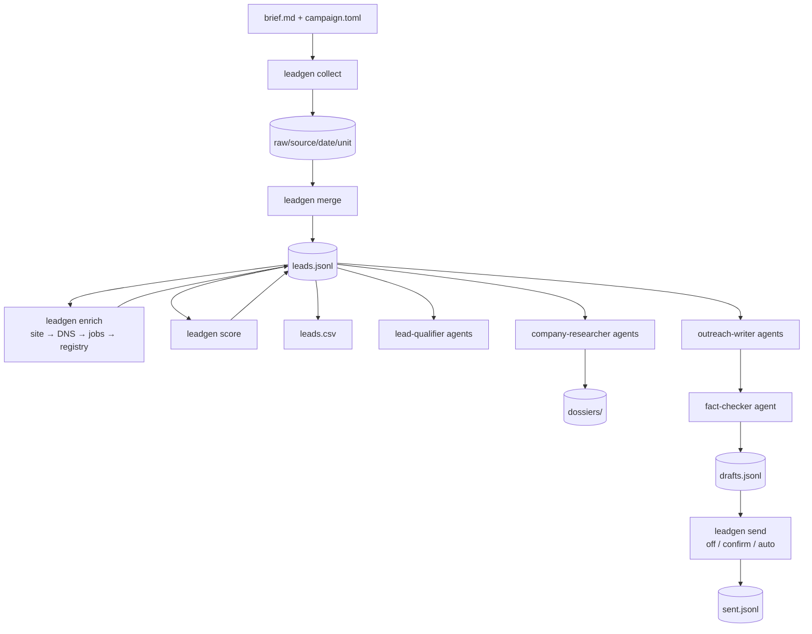

# claude-lead-gen

A Claude Code plugin that turns Claude into a lead-generation and business-research agent. You describe an offer and a market. It builds the ideal customer profile, collects businesses from public sources, crawls their sites, checks their email setup, scores them with rules you can read, researches the best ones, and writes outreach drafts where every claim cites a URL or a collected record. Stdlib Python behind a CLI, plus skills, agents, slash commands and hooks. Open-sourced under MIT.

---

## Overview

Asking a language model to "find me 50 dental clinics in Porto that need online booking" fails in predictable ways. It invents businesses, remembers websites that no longer exist, guesses email addresses, and writes outreach that mentions facts nobody checked. The model is good at the judgment parts of the job: who fits, what's worth saying, whether a page actually supports a claim. It's bad at the mechanical parts: fetching, deduplicating, counting, and remembering where something came from.

claude-lead-gen splits the work along that line. A deterministic `leadgen` CLI fetches, caches, merges, crawls, scores, exports and sends, with no model in the loop. Claude, guided by the plugin's skills, decides who to target, which sources to use, whether a lead really fits, and what to write. Both read and write the same files in the user's workspace.

```text
/leadgen:new online booking for dental clinics in Porto
/leadgen:run dental-booking-porto        collect → merge → enrich → score → export
/leadgen:research <lead-id>              cited dossier on one lead
/leadgen:drafts dental-booking-porto     drafts for tier B and better, fact-checked
/leadgen:send dental-booking-porto       gated: compliance check, dry run, your approval
```

There's also a second mode for people who don't know what to sell yet. A niche study collects what businesses currently pay freelancers for, groups those orders by product and buyer, samples the buyer segments for digital gaps, and scores them with a printed formula.

---

## Engineering Summary

The central rule is that **Claude never holds a fact the files don't.** Every fact on a lead carries a source and a date. Missing data is reported as missing, never filled in from model memory. Drafts can't be stored without evidence: the draft store rejects any draft whose `evidence` isn't a non-empty list of `{fact, source}` pairs, and a separate fact-checker agent opens each cited source before a draft is used.

The second rule is that **a human controls sending.** Drafting is free and always happens. Sending is `off` by default. In `confirm` mode, the CLI saves a content-hashed preview batch, and nothing goes out until the user re-runs the command with that batch id. A PreToolUse hook asks the user before Claude runs that approving command. The documentation states plainly that the hook is a guardrail, not a sandbox, and explains how to get a hard guarantee.

The CLI uses only the Python standard library (≥ 3.11), so installing the plugin pulls in no dependency tree. It's about 5,000 lines of package code across 13 source adapters, four enrichment steps, scoring, a niche-research module and a gated SMTP sender, with 72 offline tests that CI runs on Python 3.11–3.14. On the Claude side there are 10 skills, 5 agents, 8 slash commands and a 230-line hook.

---

## Key Features

* Pluggable source adapters: OpenStreetMap, Google Places, UK Companies House, Hacker News hiring threads, your own CSV, plus RU/CIS directories (2GIS, Yandex Maps) and freelance boards
* Free first: every workflow runs with no API keys. Keys add sources but don't change the method
* Union-find deduplication across sources on domain → phone → name + city
* Enrichment: site crawl (contacts, socials, legal IDs, people, ~90 tech fingerprints), MX/SPF/DMARC over DNS-over-HTTPS, public ATS job boards, company registries
* Transparent scoring: rules from config, summed, with a per-lead `score_breakdown`. No learned or hidden weights
* Parallel agents for research, qualification, drafting and fact-checking, each with restricted tools
* Gated email sending: `off` / `confirm` / `auto`, a global suppression list, daily and per-domain caps, compliance profiles (CAN-SPAM, GDPR, UK PECR, CASL, RU)
* Niche research: demand × gap × reach scoring over freelance orders and business samples, with the formula printed
* A `parser-builder` skill for writing a new source adapter, with workspace-local adapters for one-off sources
* Every command is idempotent and resumable, and has `--json` output for Claude

---

## Technical Stack

**Language**
Python ≥ 3.11, standard library only (`urllib`, `tomllib`, `smtplib`, `fcntl`, `concurrent.futures`)

**Claude Code integration**
Plugin + marketplace manifests, skills, subagents, slash commands, PreToolUse hooks

**Browser**
Playwright MCP, bundled, for JS-heavy pages and screenshots

**Optional providers**
Firecrawl, Exa, Brave, Tavily, Apify. Each is a separate opt-in plugin that asks for its key on install

**Storage**
Files: JSONL as the canonical record, CSV as the export, TOML for config

**Testing & CI**
`unittest` with synthetic fixtures, GitHub Actions across four Python versions, `claude plugin validate` on every manifest

---

## Architecture



The top half is the CLI, deterministic and cached. The bottom half is Claude: agents run in parallel on batches of leads and return results to the main session.

**Files are the database.** A campaign is a directory in the user's workspace: `brief.md`, `campaign.toml`, raw snapshots, `leads.jsonl`, dossiers, drafts and a send log. There's no server to run. `leadgen init` also adds the campaign data to the workspace `.gitignore`.

**Raw snapshots are never re-fetched.** Each source unit (one query × one location × one page) writes one cached raw file. Collection skips units it already has, enrichment skips leads that already have a step's result and checkpoints every 25 leads, and scoring and export are pure functions of `leads.jsonl` and the config. In a live run on 10 OSM dentists, a second `leadgen run` finished in 0.1 seconds and re-enriched nothing.

**Agents read, the main session writes.** Agents never run commands that rewrite `leads.jsonl`, `drafts.jsonl` or the suppression list. They return the `leadgen mark` / `drafts add` commands, and the main session reviews and runs them. On top of that, every writing command takes an exclusive `flock` on the campaign, so two writers queue instead of overwriting each other.

---

## Interesting Engineering Decisions

**Merging keeps what enrichment added.** Deduplication is union-find over keys from strongest to weakest: own-site domain, then phone, then normalized name + city. A 2GIS entry with a site, a Yandex entry with the same phone, and an OSM entry with the same name in the same city collapse into one lead. A re-merge carries over the `site`, `dns`, `jobs` and `registry` blocks, verified emails, scores and status from the previous file. That's why `leadgen run` never redoes enrichment. An early version lost those blocks on re-merge, so every run repeated every lookup. Fixing it added a test and a documented rule: any new enrichment block must join the carry-over list.

**Scoring is a readable config, not a model.** A rule is a set of AND conditions over dotted paths (`has = "emails"`, `field = "reviews"` + `gte = 20`, `signal = "hiring"`, `tech = ["wix"]`), with points that may be negative, or `disqualify = true` for ICP exclusions. Paths fan out through lists, so `emails.verified` matches if any email is verified. Unknown keys in a rule are an error, not silently ignored. Every lead carries the breakdown of which rules fired.

**The send gate is in the CLI, and the hook is a second layer.** The sender re-checks everything at send time, even for an approved batch. It checks the suppression list (emails, domains and phones), lead status, tier, daily cap and per-domain cap. Each draft can be sent once, ever, and `sent.jsonl` is written after each message, so a crash never re-sends. Confirm batches are content-hashed: an approved draft must be byte-identical to the one previewed, and batches expire after 24 hours. Follow-ups wait `followup_days` and are threaded with `In-Reply-To` / `References`. There's no plain-SMTP mode; TLS is always required.

**The hook never answers "allow".** It returns `deny`, `ask` or nothing. If it could allow, a safe-looking segment could carry an unsafe one chained to it. It asks before `leadgen send --approve`, including argparse abbreviations (the CLI also sets `allow_abbrev=False`), before a send chained with other commands, before shell indirection that mentions leadgen and approval, and before edits that set `send_mode = "auto"`. It denies `git add` of campaign data and `git add -f` on broad paths. It came out of a hardening review, and the documentation says exactly where it stops.

**The SSRF guard checks the address actually connected to.** The crawler fetches URLs that came from scraped data, so it runs with `public_only`. The guard allows only http(s), requires every resolved address to be global unicast, and re-checks each redirect target. The binding check sits in the connection factory, so it validates the address the socket really connects to. SNI and certificate checks still use the hostname.

**Blocked means stop.** A 429 or a captcha page raises `Blocked`, which ends that source for the run. If it happens during enrichment, that step turns off. Nothing retries hard against a wall. A broken parser raises `LayoutChanged`, and two in a row stop the source, so a silent layout change can't produce empty data that looks like real data.

**Agents run a cheap model at high effort.** The five agents run `claude-haiku-5-5` at effort `high`, with tools restricted per agent. For example, the fact-checker can read and fetch but not edit. The work is wide and bounded: one dossier, one batch of verdicts, one set of claims to check against one source each.

---

## Challenges

Most of the problems came from live runs, not from the test suite. Each run below surfaced a bug the fixtures didn't have.

**A news article became a company.** The Hacker News hiring adapter took any linked URL as the company site, so a mercurynews.com article became one lead's domain. The domain is the merge key, so this was a real problem. The fix: only a headline link or a host that looks like the company counts, ATS hosts never do, `careers.` / `jobs.` subdomains resolve to the company domain, and ATS links in a post become job boards. Leads with a domain went from 7 to 21 of 32. A related bug: leads without a domain used to get job-board tokens guessed from their name. That check was circular, so it was removed.

**The bank became the company.** On a Yandex Maps run in Kazan, the crawler took the first legal name on a page, which was often the bank listed in the payment details ("АО РАЙФФАЙЗЕНБАНК"). Bank names are now skipped, and the registry's name for the company's tax ID replaces the crawled one.

**One currency took over.** On the first live niche study, every pchel.net budget was in USD. That made USD the "most common currency", and the RUB orders dropped out of the stats. Budgets are now converted with configured rates, and the scan reports how many budgets it left out. The same run showed that a loose cluster regex ("амо") matched inside unrelated words. That's why the niche-research skill has a "read before you count" rule.

**Two security findings, fixed early.** CSV formula injection: cells starting with `= + - @` now get a `'` prefix. SSRF in the crawler: see above.

---

## Security & Compliance Considerations

* Campaign data, the suppression list and the HTTP cache are gitignored by `leadgen init`, and the hook denies adding them to git, forced or not
* Every contact records where it came from (`sources[].url`, `emails[].source`), which is the answer to "where did you get my address?"
* The sender refuses to run until a compliance profile is named and its required sender fields are filled, and it appends an identity and opt-out footer plus `List-Unsubscribe`
* The `ru` profile blocks every send unless the user sets `ru_consent = true`, because cold promotional email needs prior consent there
* Telegram, WhatsApp, LinkedIn, phone and SMS are draft-only, with deep links for manual sending, because those platforms forbid automated cold messages from personal accounts
* `/leadgen:send` can only be started by the user, not by Claude
* The documentation states the threat model and the hard-guarantee setup: keep `SMTP_*` out of the Claude Code session and run `--approve` yourself, in your own terminal
* No logged-in scraping, no captcha bypass, no bundled contact databases
* Test fixtures are synthetic

---

## Testing

* 72 offline tests, standard library `unittest`, no network
* Covered: the HTTP guard, store and CSV escaping, crawl / DNS / jobs / registry against fixture pages, scoring, merge carry-over, outreach send gating, hook decisions, the CLI end to end on the `file` source, workspace adapters, `LayoutChanged`, and the market tables
* The campaign lock has a test that fails when locking is disabled
* CI runs the suite and a CLI smoke test (init, status, a niche-study scan) on Python 3.11–3.14, plus `claude plugin validate` on the marketplace, the plugin and all five provider plugins
* Live checks are recorded with their results: OSM end to end, HN + job boards, Yandex Maps + the RKN registry, a niche-study demand scan, and the full send path to a local SMTP sink with certificate verification, threading, caps and batch re-approval refusal. Nothing left the machine

---

## Honest Limitations

* **Some live checks haven't run yet.** 2GIS setup on a clean machine, `companies_house` (needs a key), and a send through a real provider's SMTP are the remaining smoke tests. The niche-research flow has run live through the demand scan only. Supply scoring, scanner rounds and a fact-checked niche card haven't been tested end to end yet.
* **The hook is a guardrail, not a sandbox.** A shell is too expressive to parse fully, and an agent with SMTP credentials can reach the mail server without leadgen. The docs say this and give the setup that actually guarantees human approval.
* **Demand data for niche research is RU/CIS-heavy.** Only the Telegram adapter is market-agnostic. Niche studies in other markets need a new demand adapter.
* **People extraction from sites is a heuristic** and is treated as unverified until checked.
* **The default User-Agent is a browser string**, not an identifying bot UA. A bot UA is defined but isn't the default.
* **Noise from loosely formatted sources.** HN posts that open with the role instead of the company give junk names. They score low, but they stay in the list.
* **No locking on Windows**, because there's no `fcntl` there.

---

## Lessons Learned

The split between CLI and model was the most useful decision in the project. Each half is good at what the other is bad at. Without the split, the model would have to do the counting, and its counting can't be checked. Making the CLI deterministic, cached and `--json` everywhere turned Claude into a reviewer of data rather than a source of it, and made every number in a draft or niche card checkable.

The second lesson: fixtures test the parser you imagined, and live runs test the web as it is. The domain taken from a news article, the bank's name read as the company, and the currency that crowded out the others all passed the offline tests. Each needed a real run on real data to show up. Writing down every live run with what it exposed, in the repo's own state file, is how those bugs got caught and fixed.

---

## Technologies Demonstrated

* Claude Code plugin engineering: marketplace, skills, subagents, slash commands, PreToolUse hooks, bundled MCP
* Splitting work between a deterministic tool and a language model, with files as the shared state
* Entity resolution with union-find and carry-over of enrichment across re-merges
* Polite, cached, resumable collection with block detection and loud parser failure
* SSRF defence for crawling untrusted URLs, checked at connect time and on each redirect
* Email infrastructure: MX/SPF/DMARC over DNS-over-HTTPS, TLS-only SMTP, threading headers, `List-Unsubscribe`
* Human-in-the-loop safety design with a stated threat model
* Config-driven, explainable scoring
* Stdlib-only Python packaging with a multi-version CI matrix

---

## Suitable Portfolio Categories

AI Tooling · Automation · Backend Engineering · Data Engineering · OSINT · Open Source
